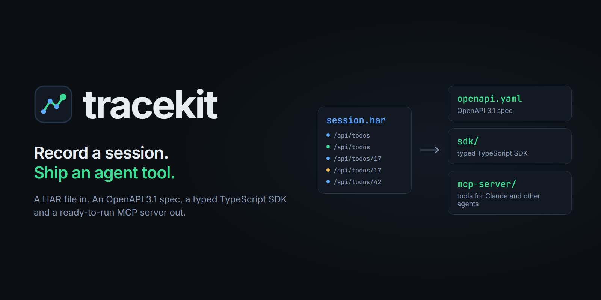
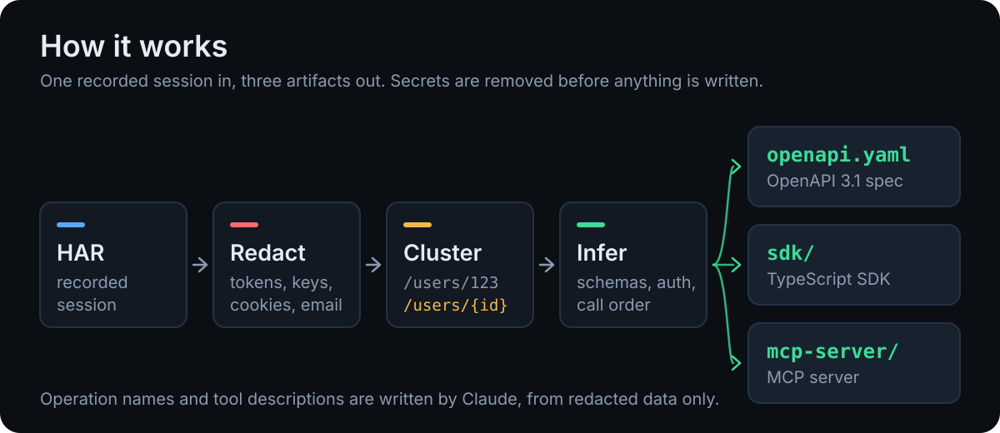
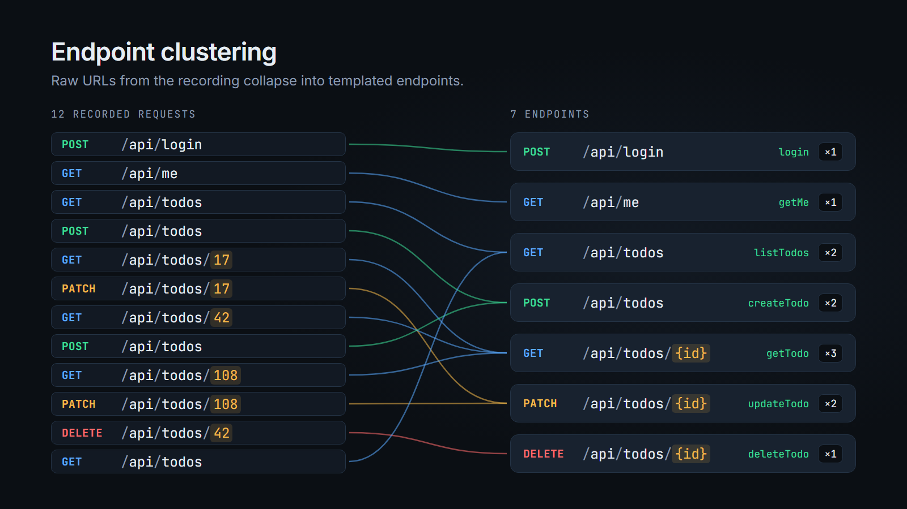
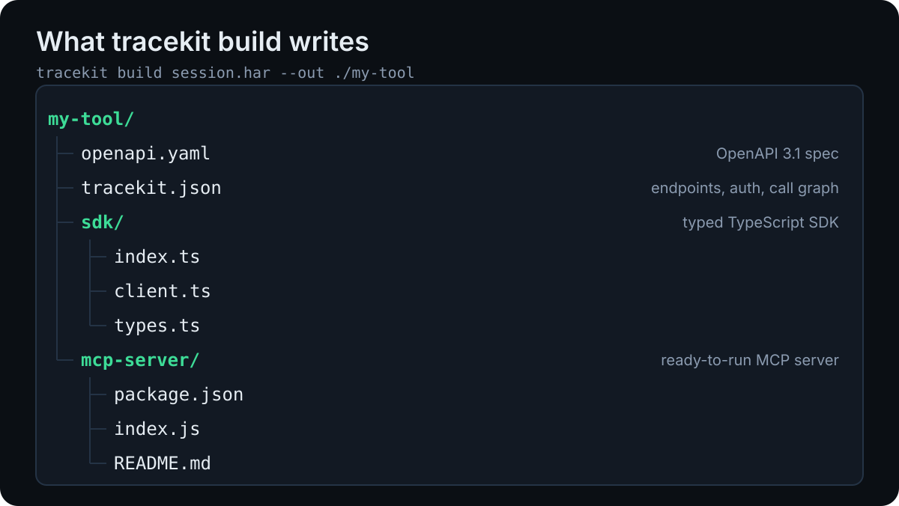

# tracekit

**Record a session. Ship an agent tool.**

Tracekit turns a recorded browser session (a HAR file) into an OpenAPI 3.1 spec, a typed TypeScript SDK and a ready-to-run MCP server.



A 76-second walkthrough:

https://github.com/user-attachments/assets/abb68638-b323-44f5-b2b1-3fde84187e95

## Why

Plenty of useful apps have no public API, no spec and no SDK, including ones you built yourself. Their web client still talks to a perfectly good JSON API; it is just undocumented. Writing the spec by hand from the Network tab is slow and goes stale.

Tracekit reads the traffic you already have and works out:

- **Endpoints**: raw URLs are clustered into templates, so `/api/todos/17` and `/api/todos/42` become `GET /api/todos/{id}`.
- **Schemas**: request and response bodies are merged into JSON Schema, with required fields, nullability and string formats.
- **Auth**: bearer token, cookie or API key, and which call issued the credential.
- **Call order**: which operations depend on which, such as "log in first" or "this id comes from that list".

Then it writes the three things an agent or a developer needs: a spec, a client and an MCP server.

## How it works



1. **Redact.** Tokens, cookies, API keys, passwords and emails are replaced with stable placeholders (`REDACTED_TOKEN_1`, `user1@example.com`). This happens first, before anything is analysed, written to disk or sent to a model.
2. **Cluster.** Path segments that look like identifiers (integers, UUIDs, long hex, ULIDs, dates, opaque tokens) become parameters. Sibling paths that differ in one position collapse too, once there are enough of them.
3. **Infer.** Samples per endpoint are merged into one schema. Auth is detected from the headers, and a call graph is built from recording order and from values that flow from one response into a later request.
4. **Generate.** `openapi.yaml`, `sdk/` and `mcp-server/`. If an Anthropic API key is available, Claude (`claude-fable-5-2`) names the operations and writes the tool descriptions from the redacted shapes. Without one, deterministic names are used.



## Responsible use

Tracekit is for **your own applications, and for applications whose terms allow automated access**. It is a documentation and tooling generator, not a way around access controls.

- Record only sessions you are authorised to record, with accounts that are yours.
- Read the target's terms of service first. Many services prohibit automated access or reverse engineering; if they do, do not point tracekit at them.
- Tracekit does not bypass authentication, rate limits, CAPTCHAs or bot detection, and the generated code does not try to. It replays the same calls your browser made, with credentials you supply.
- A HAR file is sensitive. It can hold session tokens, personal data and private content. Redaction is on by default and covers the common cases, but it is pattern-based and cannot recognise every secret. Review a HAR before sharing it, and prefer `tracekit redact` output over the raw file.
- Respect the target's rate limits when you run the generated SDK or MCP server.

## Install

Requires Node 22 or newer. Tracekit is not on npm yet, so install from source:

```bash
git clone https://github.com/hesselb20-ctrl/tracekit
```

```bash
cd tracekit
```

```bash
npm install
```

```bash
npm run build
```

`npx tracekit --help` now works inside the repo.

## Quickstart with the example API

The repo ships a tiny Express todo API, a HAR recorded against it, and the generated output in [`examples/generated`](examples/generated).

Generate a tool from the recording:

```bash
npx tracekit build examples/session.har --out ./my-tool --name todo
```

```text
http://localhost:4010  (16 API calls out of 17 entries)
Redacted 23 secret values (6 email, 1 password, 16 token)

Endpoints
  POST /api/login         login  (1 call)
  GET /api/me             getMe  (1 call, auth)
  GET /api/todos          listTodos  (4 calls, auth)
  GET /api/todos/{id}     getTodo  (4 calls, auth)
  POST /api/todos         createTodo  (2 calls, auth)
  PATCH /api/todos/{id}   updateTodo  (2 calls, auth)
  DELETE /api/todos/{id}  deleteTodo  (2 calls, auth)

Auth: bearer token, issued by POST /api/login (token)
```



Start the example API in one terminal:

```bash
npm run example:api
```

In another, install the generated server's one dependency and run a real MCP round trip against it:

```bash
npm run example:mcp
```

To record your own session: open DevTools, go to the Network tab, use the app, then choose "Save all as HAR with content". Run `tracekit inspect session.har` to see what was found before generating anything.

### Commands

| Command | What it does |
|---|---|
| `tracekit build <har> --out <dir>` | Generate `openapi.yaml`, `tracekit.json`, `sdk/` and `mcp-server/`. |
| `tracekit inspect <har>` | Print endpoints, auth and call order. Writes nothing. |
| `tracekit redact <har> --out <file>` | Write a redacted copy of a HAR. |

Useful flags: `--name`, `--origin <url>` when the recording spans several hosts, `--min-distinct <n>` to tune slug clustering, `--keep-har` to also write the redacted HAR, `--no-ai`, `--model <id>`.

### Claude naming

Set `ANTHROPIC_API_KEY` and tracekit asks Claude to name operations and write tool descriptions. Only a compact summary of the redacted analysis is sent: methods, path templates, field names and types. Recorded values are not sent. If there is no key, the request fails, or the model declines, tracekit falls back to deterministic names and says why. `--no-redact` disables the model call entirely, so unredacted traffic never leaves your machine.

### Using the SDK

```ts
import { createClient } from "./my-tool/sdk/index.js";

const todo = createClient({ baseUrl: "http://localhost:4010" });
await todo.login({ email: "ada@example.com", password: "tracekit-demo" }); // token is kept on the client
const open = await todo.listTodos({ done: false });
const created = await todo.createTodo({ title: "Ship it" });
await todo.updateTodo(created.id, { done: true });
```

## MCP config

Install the server's dependency once:

```bash
npm install --prefix ./my-tool/mcp-server
```

Add it to Claude Code:

```bash
claude mcp add todo -- node /absolute/path/to/my-tool/mcp-server/index.js
```

Or put it in `.mcp.json` (the same shape works for Claude Desktop's `claude_desktop_config.json`):

```json
{
  "mcpServers": {
    "todo": {
      "command": "node",
      "args": ["/absolute/path/to/my-tool/mcp-server/index.js"],
      "env": {
        "TODO_BASE_URL": "http://localhost:4010"
      }
    }
  }
}
```

Credentials are read from the environment (`TODO_TOKEN` here) or obtained through the generated `login` tool. Either way they stay inside the server process: when a login response contains a token, the server stores it and replaces it in the tool result, so it does not enter the model's context.

## Tutorial


The playable version is at the top of this page; the file is [media/tutorial.mp4](media/tutorial.mp4). It is built in code with Remotion; the source is in [`tutorial/`](tutorial).

## Repository layout

| Path | Contents |
|---|---|
| `core/` | HAR parser, redaction, path templating, schema inference, auth detection, call graph. No dependencies. |
| `cli/` | The `tracekit` command and the OpenAPI, SDK and MCP generators. |
| `examples/` | Todo API, recorded HAR, generated output, MCP round-trip script. |
| `tutorial/` | Remotion project for the video and the README images. |
| `media/` | Rendered video, GIF and images. |

Tests: `npm test` (Vitest) covers path templating, schema inference, redaction and the generators.

## Limitations

- **You only get what you recorded.** Endpoints, fields and error responses that did not occur in the session are not in the output. A field present in every sample is marked required even if the API treats it as optional (PATCH bodies are the exception: all fields are optional).
- **JSON over HTTP only.** Form posts, multipart uploads, GraphQL (one endpoint, many operations), WebSockets, SSE and gRPC-web are not modelled.
- **Redaction is heuristic.** It covers auth headers, cookies, known key formats, JWTs, emails and sensitive field names. A secret in an unusual field under an innocent name can get through. Review before sharing.
- **Auth is replayed, not re-implemented.** Bearer tokens, API keys and cookies are supported. OAuth redirects, token refresh, CSRF tokens, request signing and MFA are not.
- **Slug clustering needs evidence.** Identifier-shaped segments are always templated; word-like slugs need at least four distinct siblings (`--min-distinct`), and plain lowercase usernames may stay literal.
- **One origin per build.** The busiest origin is analysed; use `--origin` to choose another.
- **Claude naming has not been run against the live API yet.** No API key was available when this repo was built, so that path is covered by tests with a stubbed client, and the committed example uses the deterministic names.
- **Not on npm.** Install from source for now.

## Roadmap

- Publish `tracekit` and `@tracekit/core` to npm
- Merge several HAR files into one analysis
- Form and multipart bodies; GraphQL operation splitting
- Token refresh and CSRF handling in the generated clients
- Shared `components/schemas` in the OpenAPI output, with detected entity names
- Enum and pagination detection
- Python SDK target
- Streamable HTTP transport for the generated MCP server
- A browser extension that records and redacts in one step

## License

[MIT](LICENSE)
