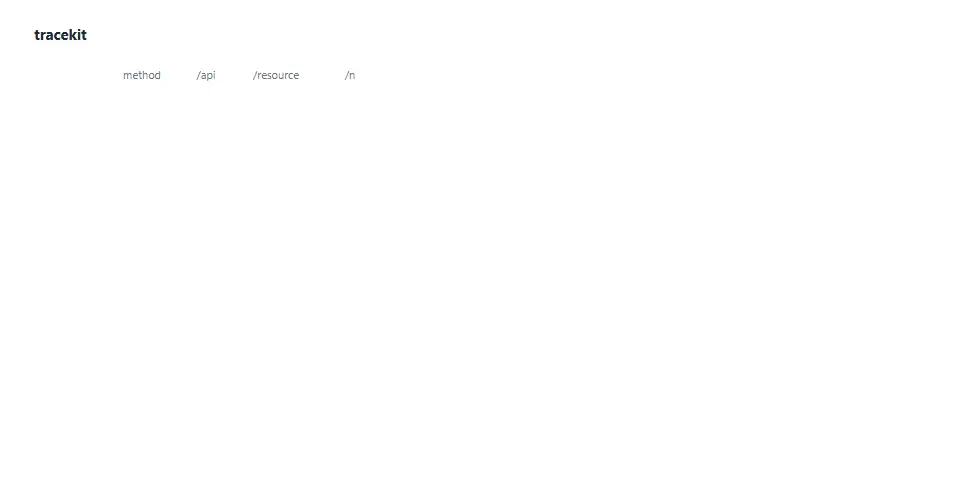

# tracekit

HAR recording in. OpenAPI spec, SDK and MCP server out.


<sub>From `examples/session.har` and `examples/generated/tracekit.json`. One local demo API, recorded by a script; the generated SDK was not compiled.</sub>

## What it is

tracekit reads a recording of a browser session, the HAR file you export from the Network tab, and
works out the API the web app was calling. It writes that API down as an OpenAPI 3.1 spec, a typed
TypeScript client and an MCP server, so a developer or an AI agent can call it directly.

It is a prototype, version 0.1.0. It has been tested on one small todo API that runs locally and was
recorded by a script. It is not on npm.

## Why it exists

**The problem.** Many web apps have no public API, no spec and no SDK, including apps you built
yourself. Their front end still talks to a JSON API. That API is just undocumented.

**What was missing.** Writing a spec by hand from the Network tab is slow and goes stale. tracekit
reads traffic you already have and derives the endpoints, schemas, auth and call order from it. It
removes secrets before it looks at anything.

**Who it is for.** Developers who want a spec, a client or an agent tool for their own apps, or for
apps whose terms allow automated access. It is not a way around access controls. The generated code
replays the calls your browser made, with credentials you supply.

## How it works

1. **Parse.** The HAR is read and pages, static assets, preflights and HEAD requests are dropped.
   What remains are JSON calls, fetch and XHR calls, and mutations such as a `DELETE` that returns 204.
2. **Redact.** Auth headers, cookies, JWTs, known key formats, sensitive field names and emails are
   swapped for stable placeholders such as `REDACTED_TOKEN_1` and `user1@example.com`. The same secret
   always gets the same placeholder, so tracekit can still see that the token from `/login` is the one
   sent later. This runs before any analysis, file write or model call.
3. **Pick an origin.** The origin with the most calls is analysed. `--origin` picks another.
4. **Cluster.** Path segments that look like identifiers (integers, UUIDs, long hex, ULIDs, dates,
   opaque tokens) become parameters, so `/api/todos/17` and `/api/todos/42` become
   `/api/todos/{id}`. Word-like slugs collapse only with at least four distinct siblings by default.
5. **Infer.** Request and response samples per endpoint are merged into one JSON Schema. Auth is
   detected as bearer token, API key or cookie, along with the call that issued it. A call graph
   records which call fed an id or a credential into a later one.
6. **Name.** Operations get deterministic names such as `listTodos`. Optionally, Claude rewrites the
   names and descriptions from a summary of shapes only: methods, path templates, field names and
   types, no recorded values. `--no-ai` skips this step.
7. **Generate.** `openapi.yaml`, `tracekit.json`, `sdk/` and `mcp-server/` are written to the output
   folder.



<sub>One scripted recording of a local demo API (<code>examples/session.har</code>); templates and schema as written to <code>tracekit.json</code> and <code>openapi.yaml</code>.</sub>

## Capabilities

What the code does today.

- **HAR parsing.** Accepts HAR 1.2 JSON, keeps API calls, drops assets and preflights. `core/src/har.ts`
- **Redaction.** Pattern-based, on by default, stable placeholders. Also available on its own as
  `tracekit redact`. `core/src/redact.ts`
- **Path templating.** Shape rules plus sibling counting, tunable with `--min-distinct`.
  `core/src/template.ts`, `core/src/endpoints.ts`
- **Schema inference.** Merges samples into JSON Schema with required fields, nullability and string
  formats. `core/src/schema.ts`
- **Auth detection.** Bearer, API key in header or query, cookie, and the call that issued it.
  `core/src/auth.ts`
- **Call graph.** Order, data and auth edges between operations. `core/src/sequence.ts`
- **OpenAPI output.** OpenAPI 3.1 YAML with security schemes. `cli/src/openapi.ts`
- **TypeScript SDK.** A typed client with one method per operation. A login response's token is kept on
  the client. `cli/src/sdk.ts`
- **MCP server.** A stdio server with one tool per operation. Credentials come from an environment
  variable or the login tool and stay in the server process: the login result shows
  `[stored by the MCP server]` instead of the token. `cli/src/mcp.ts`
- **Optional Claude naming.** Falls back to deterministic names on any failure and says why.
  `cli/src/naming.ts`
- **Tests.** 73 Vitest tests over templating, schemas, redaction and the generators. `core/test`, `cli/test`

Known limits, from the repository's own documentation and the code:

- You only get what you recorded. Endpoints, fields and errors that did not occur are missing. A field
  present in every sample is marked required, except in `PATCH` bodies.
- JSON over HTTP only. Form posts, multipart, GraphQL, WebSockets, SSE and gRPC-web are not modelled.
- Redaction is heuristic. A secret in an unusual field under an innocent name can get through.
- Auth is replayed, not re-implemented. OAuth redirects, token refresh, CSRF tokens, request signing
  and MFA are not supported.
- One origin per build.
- The Claude naming path has never been run against the live Anthropic API. It is covered by tests
  with a stubbed client, and the committed example uses deterministic names.
- The only recording it has been tested on is `examples/session.har`, made by a script against the
  local demo API, not a browser export from a real app.


<sub>Placeholders counted in <code>session.redacted.har</code>. The naming payload was built and checked locally; the live naming call has never been run.</sub>

## Quick start

Requires Node 22 or newer. The commands below were run on Windows 11 with Node 26.13 and npm 11.20,
in Git Bash. macOS and Linux were not tested. tracekit is not on npm, so install from source.

```bash
git clone https://github.com/hesselb20-ctrl/tracekit.git
cd tracekit
npm ci
npm run build
```

Run the tests. Expect `4 passed` test files and `73 passed` tests.

```bash
npm test
```

Inspect the committed example recording. Writes nothing. Expect 16 API calls out of 17 entries,
23 redacted values, 7 endpoints and `Auth: bearer token, issued by POST /api/login (token)`.

```bash
node cli/bin/tracekit.js inspect examples/session.har
```

Generate the spec, SDK and MCP server without calling Claude. Expect
`Names and descriptions: deterministic (--no-ai)` and `Wrote 9 files`. Apart from line endings, the
output matched the committed [`examples/generated`](examples/generated) exactly.

```bash
node cli/bin/tracekit.js build examples/session.har --out ./my-tool --name todo --no-ai --keep-har
```

Run a real MCP round trip. This installs the generated server's one dependency from npm, starts the
demo API on port 4010, connects an MCP client over stdio and calls the tools. Expect 7 tools, an
error before login, the token shown as `[stored by the MCP server]`, then create, update and delete,
and `MCP round trip OK`.

```bash
npm run example:mcp
```

Write a redacted copy of a HAR. Expect `Redacted 23 secret values`.

```bash
node cli/bin/tracekit.js redact examples/session.har --out ./clean.har
```

Not run here: naming with Claude (needs `ANTHROPIC_API_KEY`; drop `--no-ai`), and adding the generated
server to an MCP client such as Claude Code. Registration steps are in the generated
[`examples/generated/mcp-server/README.md`](examples/generated/mcp-server/README.md). To record your
own session, open DevTools, use the app with the Network tab open, and choose "Save all as HAR with
content".

## Stack, status, roadmap

**Stack**

| Layer | Built with |
|---|---|
| Core analysis | TypeScript, Node 22+, no runtime dependencies |
| CLI | TypeScript, `yaml`, `@anthropic-ai/sdk` for optional naming |
| Generated MCP server | Plain JavaScript, `@modelcontextprotocol/sdk`, stdio transport |
| Demo API | Express 5, in memory |
| Tests | Vitest |
| Tutorial video | Remotion, separate project in `tutorial/` |

**Status**

| Part | State |
|---|---|
| Core pipeline and CLI | Built. 73 tests pass. Run here on the demo recording only. |
| Generated SDK | Generated; tests check its text output. Never compiled or called against an API here. |
| Generated MCP server | Round trip against the local demo API passes. |
| Claude naming | Tested with a stubbed client only. Never run against the live API. |
| Real-world recordings | None tested. The only HAR is script-recorded. |
| Distribution | Not on npm. No CI. |

**Roadmap.** Items the previous README listed as planned. None are built.

1. Publish `tracekit` and `@tracekit/core` to npm.
2. Merge several HAR files into one analysis.
3. Form and multipart bodies; GraphQL operation splitting.
4. Token refresh and CSRF handling in the generated clients.
5. Shared `components/schemas` in the OpenAPI output, with detected entity names.
6. Enum and pagination detection.
7. A Python SDK target.
8. Streamable HTTP transport for the generated MCP server.
9. A browser extension that records and redacts in one step.

**Documents**

| File | Contents |
|---|---|
| [`examples/README.md`](examples/README.md) | The demo API, how the recording was made, how to regenerate the output |
| [`examples/generated/`](examples/generated) | Committed output of `tracekit build` on the demo recording |
| [`tutorial/README.md`](tutorial/README.md) | The Remotion project that renders the video |
| [`media/tutorial.mp4`](media/tutorial.mp4?raw=true) | 76-second walkthrough video, about 3.8 MB download |

**Responsible use.** Record only sessions you are authorised to record, with your own accounts. Read
the target's terms first; many prohibit automated access. A HAR file can hold session tokens and
personal data. Review it before sharing, and prefer `tracekit redact` output over the raw file.

## License

MIT. See [`LICENSE`](LICENSE).
